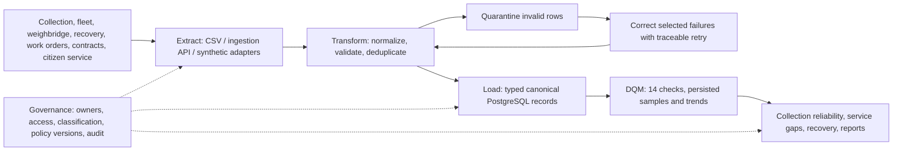

# Integration PowerPoint review — Waste Hub

Reviewed on 27 October 2026 against the supplied `integration.pptx`: all 19 slides, including the diagram embedded in slide 13. This review applies its EDM concepts to the existing municipal waste/recycling project. It does not treat every illustrated industry, law or integration method as a feature that the prototype implements.

## Requirement coverage

| Deck reference                                        | What the project demonstrates                                                                                                                                                                                  | Evidence and limits                                                                                                                                                                                                 |
| ----------------------------------------------------- | -------------------------------------------------------------------------------------------------------------------------------------------------------------------------------------------------------------- | ------------------------------------------------------------------------------------------------------------------------------------------------------------------------------------------------------------------- |
| Slides 2–3: integration, governance and DQM together  | Seven registered source systems feed typed canonical operational records; governance and DQM use those same records.                                                                                           | Source catalog, import history, operations, governance, quality and API-backed overview.                                                                                                                            |
| Slides 4–7: extract, transform, load                  | CSV and JSON ingestion through REST endpoints; in-process synthetic provider snapshots; trimming, uppercase vehicle registrations, numeric validation and timezone normalization before canonical persistence. | `backend/src/modules/integrations/` and `canonical/`; tests cover malformed rows, references and normalized values. External providers are simulated.                                                               |
| Slide 6: deduplication and correction                 | Natural source keys, payload hashes, idempotent replay, quarantine and selected corrected retry prevent repeated imports from duplicating successful rows.                                                     | Integration tests and walkthrough checkpoints 5–7. Corrected retry preserves the successful row.                                                                                                                    |
| Slides 3, 12–13: cleansing, validation and monitoring | Fourteen executable DQM checks, persistent observations, readable failure samples, remediation reasons and real trend history.                                                                                 | Every rule is tested against clean data and a targeted defect. Remediation acknowledgement preserves the score; correction plus a new run remeasures it.                                                            |
| Slides 9, 12–13: governance and security              | Ownership/stewardship, classification, retention metadata, organization-scoped roles, masked citizen identities, policy version checks and immutable audit.                                                    | Integration tests cover forbidden writes, tenant isolation, public-PII rejection, stale policies, session rotation and audit immutability. Automatic retention deletion is not implemented.                         |
| Slides 7, 9, 12: useful outcomes                      | Collection reliability, completed/missed stops, operational reports, recovery/diversion and audit-backed CSV exports.                                                                                          | Tests reconcile dashboard/report values with canonical records. No event evidence is identified as a data gap rather than proof of a missed collection.                                                             |
| Slide 8: integration options                          | The implemented approach is bounded batch ETL plus request/response ingestion APIs and synthetic adapters.                                                                                                     | CDC, data virtualization, a warehouse ELT service, data fabric/iPaaS and live provider synchronization are not implemented.                                                                                         |
| Slides 10, 12: resilience and scale                   | Pagination, 500-record import caps, source locks, idempotency, transactional integrity and snapshot-based quality evaluation.                                                                                  | Tests cover contention and failed executions. Enterprise load, distributed throughput and multi-cloud operation have not been established.                                                                          |
| Slide 19: presentation activity                       | The flowchart and comparative matrix below make the required source → method → governance → output mapping explicit.                                                                                           | Municipal waste/recycling is the user's selected domain. The activity names Healthcare, Banking, Retail, Manufacturing and Education; the alternative domain needs instructor acceptance if that list is mandatory. |

## Municipal-operations flowchart

## Comparative matrix for the presentation

| Project / industry                        | Sources                                                                                     | Implemented integration                                                      | Governance                                                                                                       | Outputs                                                                           |
| ----------------------------------------- | ------------------------------------------------------------------------------------------- | ---------------------------------------------------------------------------- | ---------------------------------------------------------------------------------------------------------------- | --------------------------------------------------------------------------------- |
| Water Hub / water utilities               | Billing, metering, production, laboratory, field response, customer service, asset registry | CSV/JSON ingestion APIs; synthetic adapters; canonical ETL; quarantine/retry | Domain-scoped roles; customer masking; lab/billing retention guards; owners and immutable audit                  | Water-quality/leak overview; NRW lineage; meter reliability; CSV reports          |
| Waste Hub / municipal waste and recycling | Collection, fleet, weighbridge, recovery, work orders, contracts, citizen service           | CSV/JSON ingestion APIs; synthetic adapters; canonical ETL; quarantine/retry | Organization-scoped roles; citizen identity masking; owners/classification; versioned policy and immutable audit | Collection reliability; missed stops; recovery/diversion; operational CSV reports |

## Final verification

- Architecture, full lint and backend/frontend/tools TypeScript checks passed. The changed walkthrough also passed targeted lint and tools TypeScript checks.
- Unit tests: **11 passed**. Disposable local PostgreSQL integration tests: **35 passed**, including authorization and integrity coverage.
- Backend and Next.js production builds passed from the Desktop project.
- The local HTTP walkthrough passed **18 checkpoints**: four role sign-ins, bad-row quarantine, replay, selected correction, measured DQM improvement, policy control, permissions, masking, export, audit and logout.
- Walkthrough evidence now records the actual execution time instead of a hard-coded date. A `finally` block revokes remaining walkthrough sessions after a failure. No runtime API contract or schema changed.

All database tests and walkthrough writes used local PostgreSQL. No Neon query, migration, seeding or operational cleanup was performed during this review. Private credentials were not changed or included in this report. Logs are in ignored `.local/final-review-*.txt`; walkthrough evidence is `.local/demo-evidence/results.json`.

## Limits to state during the presentation

This is a working educational prototype with synthetic provider data. It does not establish legal, security or operational certification. Passwords use **scrypt**, with hashed opaque server sessions; they do not use bcrypt. Production configuration requires HTTPS and remote PostgreSQL TLS, but deployed encryption, backup restoration and production operational controls were not independently verified here.

Live connectors, scheduled background ingestion/quality checks, alert delivery, automatic retention processing, password recovery, MFA and SSO remain future work. Quality monitoring is explicitly triggered; no polling, reconnect refresh or automatic error-retry loop was added.

The built-in browser connector remained disabled, but the user-authorized Mercado Chrome fallback completed the [desktop browser review](browser-review.md), including DQM execution, trends, readable samples, governance/import controls, reliability, users and logout. A laptop-height sidebar defect was fixed and reverified; architecture, lint, TypeScript and production builds passed afterward. This does not establish exhaustive browser/device coverage. CI configuration was inspected, but no remote workflow, commit, push or deployment was triggered.

For the demonstration sequence, see [school presentation](school-presentation.md). For file locations and request flow, see [project map](project-map.md).
